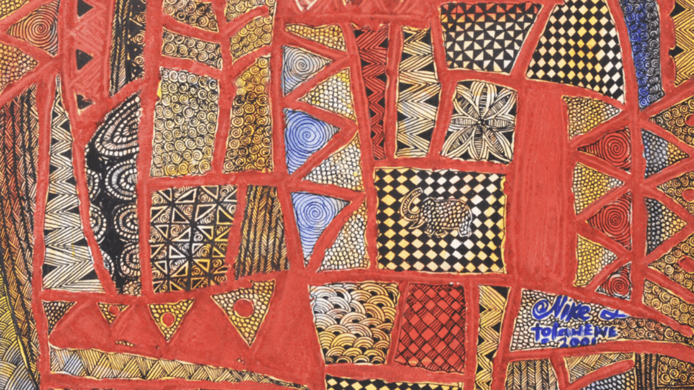

# Heritage Revisited — an Omarchy theme

A dark Omarchy theme sampled from *Heritage Revisited* (2001), a pen-and-ink
painting by **Nike & Tola Wewe** — bright terracotta, ocher gold, cream, ink
black, and slate-cobalt patchwork.



## Install

```
omarchy theme install https://github.com/willb335/omarchy-heritage-revisited-theme
```

Or from the Omarchy menu: **Install > Style > Theme**, and paste the repo URL.

## Notes

- Ships one background (`backgrounds/`) plus lock-screen and theme-switcher
  previews. Terminal, Hyprland, shell, and editor configs are generated from
  `colors.toml`.
- Pairs well with the [`miasma.nvim`](https://github.com/xero/miasma.nvim)
  Neovim colorscheme. Add it to your own config:

  ```lua
  return {
    { "xero/miasma.nvim" },
    {
      "LazyVim/LazyVim",
      opts = {
        colorscheme = "miasma",
      },
    },
  }
  ```
- Uses the [Yaru-red](https://github.com/ubuntu/yaru) icon theme.

## Artwork attribution

The wallpaper in `backgrounds/` is a reproduction of:

> **Nike & Tola Wewe**, *Heritage Revisited*, 19 x 22 inches, pen and ink on
> canvas, 2001.

All rights to the artwork remain with the artists. It is included here solely
as a desktop wallpaper for personal use, with credit. Theme colors and config
files are MIT licensed (see [LICENSE](LICENSE)); the artwork is **not** covered
by that license.
